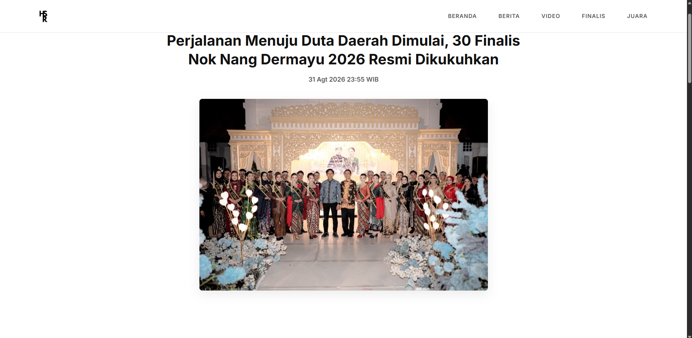
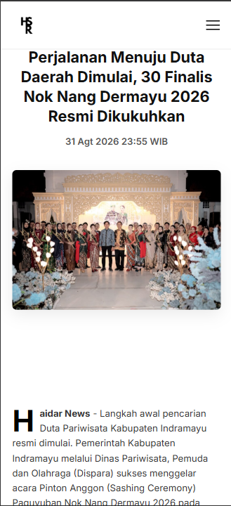

## Nok Nang Dermayu 2025
Sebuah website portofolio yang menampilkan informasi mengenai Pasanggiri Nok Nang Dermayu 2025, termasuk berita, video, daftar finalis, dan daftar juara. Website ini dirancang dengan tampilan responsif dan modern menggunakan HTML, CSS, dan JavaScript.

## Fitur
- **Navigasi responsif**: Hamburger menu untuk tampilan mobile, navigasi standar untuk desktop.
- **Tampilan berita**: Berita lengkap mengenai kegiatan.
- **Video**: Integrasi video dari YouTube.
- **Daftar finalis**: Tabel dan daftar finalis dengan detail.
- **Daftar juara**: Daftar pemenang dari tahun 2015 hingga 2025.

## Cara Menjalankan
1. Unduh atau clone repository ini.
2. Buka file `index.html` di browser web Anda.

##Teknologi yang digunakan
- HTML5
- CSS3
- JavaScript ES6+

## Kontribusi
Proyek ini dibuat sebagai tugas kuliah dengan mengikuti prinsip-prinsip desain modern dan pengembangan web responsif.

## Screenshot

### Desktop View

### Mobile View

